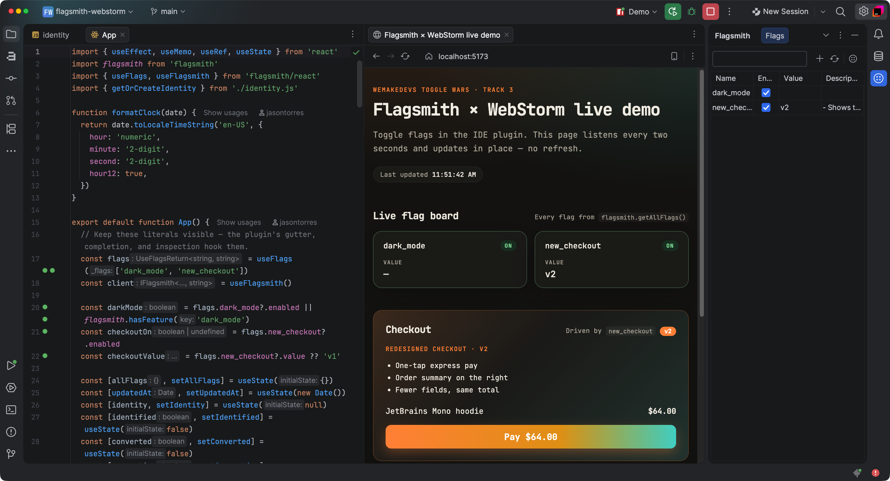
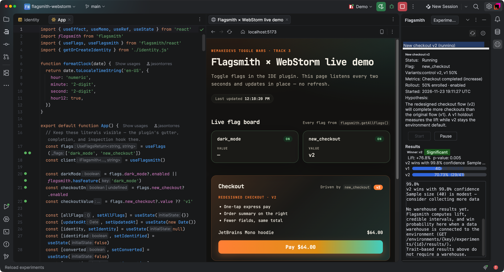

# Flagsmith Feature Flags

A [Flagsmith](https://www.flagsmith.com/) panel for [WebStorm](https://www.jetbrains.com/webstorm/) and other JetBrains IDEs. Browse and search flags, toggle them without leaving the editor, and inspect experiments from the same sidebar.

This is an unofficial community plugin. It is not affiliated with, endorsed by, or officially supported by Flagsmith.

Built by [Jason Torres](https://github.com/jasonetorres), Developer Advocate at JetBrains.





## What you get

- A **Flags** tool window: search flags by name, toggle them in place, edit the environment value, and create a new flag with the + button.
- **In-editor flag awareness** in JS/TS/JSX/TSX: a gutter icon on known flag names in `useFlags`, `flagsmith.hasFeature` / `getValue`, and `flags.x` / `flags['x']`. The tooltip shows enabled/value/description. Click it to toggle, copy the value, or open the Flagsmith dashboard. Completion offers known flag names inside those string literals. An **Unknown Flagsmith flag** inspection warns when a literal isn't in your environment, with a quick fix to create it. These editor features use the JavaScript plugin when it is available, and a text-based fallback otherwise, so the plugin still loads in IDEs without JavaScript support.
- An editor popup action, **Create Flagsmith Flag from Selection**.
- An **Experiments** tab: list Flagsmith experiments, inspect status, flag, variants, metrics, rollout, and hypothesis, start / pause / complete an experiment, and see trait-based results with a winner, lift, p-value, a Significant/Not significant badge, and per-variant conversion bars.
- Notifications if a toggle fails, with the checkbox rolled back.
- Settings under **Settings | Tools | Flagsmith**. Your Organisation API key is stored in the IDE password safe, not in project files.

## Prerequisites

- A JetBrains IDE 2026.1 or later (build `261+`). The plugin depends only on the IntelliJ Platform, so it can run in WebStorm, IntelliJ IDEA, PyCharm, and other IntelliJ-based IDEs.
- JDK 21, to build from source.
- [Docker](https://docs.docker.com/get-docker/), if you are running Flagsmith locally.

## Self-host Flagsmith

The official Flagsmith docker-compose file is the fastest way to get a local instance:

```bash
curl -o docker-compose.yml https://raw.githubusercontent.com/Flagsmith/flagsmith/main/docker-compose.yml
docker compose up -d
```

Open [http://localhost:8000](http://localhost:8000), create an organisation, a project, and an environment (Development is fine).

### API keys

The plugin needs two keys. Neither of them belongs in git.

1. **Organisation API key** — used for the management API (listing projects, toggling flags, reading experiments). In the Flagsmith dashboard, go to **Organisation Settings > API Keys** and create a key.
2. **Environment key** — the client-side SDK key for that environment. Open the environment, then the SDK keys page, and copy the key.

In this README, the environment key is written as `<your-environment-key>`.

## Build and run the plugin

Clone the repo and start a sandbox IDE that already has the plugin installed:

```bash
git clone https://github.com/jasonetorres/flagsmith-webstorm.git
cd flagsmith-webstorm
./gradlew runIde
```

`runIde` is the easiest way to try changes. You do not need to install a zip into your daily WebStorm every time you rebuild.

To produce an installable plugin:

```bash
./gradlew buildPlugin -x buildSearchableOptions
```

Then in any JetBrains IDE: **Settings | Plugins | gear icon | Install Plugin from Disk…** and choose the zip under `build/distributions/` (for this version, `flagsmith-plugin-0.1.0.zip`).

## Configure the plugin

Open **Settings | Tools | Flagsmith** and fill in:

- **API URL:** `http://localhost:8000/api/v1` for a local Docker instance. For Flagsmith Cloud, use `https://api.flagsmith.com/api/v1`.
- **Organisation API key:** pasted once; the IDE stores it in the password safe (Keychain on macOS).
- **Environment key:** `<your-environment-key>`.

Click **Test Connection**, then open the Flagsmith tool window on the right sidebar and hit Refresh.

## How it uses Flagsmith

The plugin talks to the open source Flagsmith HTTP API. With the API URL set to `http://localhost:8000/api/v1`, those calls are:

| What | Method and path | Auth |
| --- | --- | --- |
| Test connection | `GET /projects/` | `Authorization: Api-Key <org key>` |
| List flags | `GET /flags/` | `X-Environment-Key: <environment key>` |
| Toggle a flag | `PATCH /environments/<environment key>/featurestates/<id>/` with `{"enabled": true/false}` | `Authorization: Api-Key <org key>` |
| List experiments | `GET /environments/<environment key>/experiments/` | `Authorization: Api-Key <org key>` |
| Experiment detail | `GET /environments/<environment key>/experiments/<id>/` | `Authorization: Api-Key <org key>` |
| Warehouse results | `GET /environments/<environment key>/experiments/<id>/results/` | `Authorization: Api-Key <org key>` |
| Warehouse exposures | `GET /environments/<environment key>/experiments/<id>/exposures/` | `Authorization: Api-Key <org key>` |
| Trait-based A/B results | `GET /environments/<environment key>/experiments/results/?feature=<flag name>` | `Authorization: Api-Key <org key>` |
| Environment (project id) | `GET /environments/<environment key>/` | `Authorization: Api-Key <org key>` |
| Create a flag | `POST /projects/<project id>/features/` with `name`, `description`, `default_enabled`, `initial_value`, `type` | `Authorization: Api-Key <org key>` |
| Edit a flag value | `PATCH /environments/<environment key>/featurestates/<id>/` with `{"feature_state_value": "..."}` | `Authorization: Api-Key <org key>` |
| Start / pause an experiment | `POST /environments/<environment key>/experiments/<id>/start/` or `/pause/` | `Authorization: Api-Key <org key>` |
| Complete an experiment | `POST /environments/<environment key>/experiments/<id>/complete/` with `{"rollout_decision": "control"|"variant"|"disable"}` | `Authorization: Api-Key <org key>` |

The trait-based results endpoint is separate from `/experiments/<id>/results/`. It looks at identity traits named `exp_{feature}_variant` and `exp_{feature}_converted`. Warehouse results need a connected data warehouse and may be empty on a fresh self-hosted instance.

## Demo app

This repo includes a small React + Vite showcase in [`demo/`](demo/) so you can exercise the plugin from the same project. It uses JSX (not TypeScript) on purpose: the plugin's gutter icons, completion, and inspections hook flag names in `useFlags(['dark_mode', 'new_checkout'])` and `flagsmith.hasFeature('dark_mode')`.

The app wraps the tree in `FlagsmithProvider` from `flagsmith/react`, calls `flagsmith.startListening(2000)`, and sets `cacheFlags: false`, so the UI updates about two seconds after you flip a flag in WebStorm.

- A live flag board renders every flag from `flagsmith.getAllFlags()` as cards (name, ON/OFF, value) and flashes when a value changes, plus a last-updated 12-hour clock.
- `dark_mode` switches the whole page theme.
- `new_checkout` reveals a mock checkout card. The multivariate value picks v1 (classic form) or v2 (gradient treatment with the value as a badge).
- The Experiment panel assigns a random Flagsmith identity (kept in `localStorage`), shows "You are in variant: X", and a **Complete checkout** button that writes `exp_new_checkout_converted=true` and `exp_new_checkout_variant=<variant>` so clicks show up in the plugin's Experiments tab.

Copy [`demo/.env.example`](demo/.env.example) to `demo/.env.local` and fill in your environment key (do not commit `.env.local`):

```bash
VITE_FLAGSMITH_ENV_KEY=<your-environment-key>
VITE_FLAGSMITH_API=http://localhost:8000/api/v1/
```

Then:

```bash
cd demo
npm install
npm run dev
```

Or, in WebStorm, use the **Demo** run configuration (`.run/Demo.run.xml`), which runs `npm run dev` in `demo/`.

Open the Vite URL (usually `http://localhost:5173`), put it next to WebStorm, and toggle flags in the plugin.

[cat-generator](https://github.com/jasonetorres/cat-generator) is a second example of the same live-update pattern (`dark_mode` and `new_checkout`) if you want another app running next to the plugin.

## Publishing

This is meant to be a real JetBrains Marketplace plugin, not only a hackathon demo.

1. Create a [JetBrains Marketplace](https://plugins.jetbrains.com/) account and a Marketplace upload token (Hub / Marketplace profile, then generate a token for plugin uploads).
2. Sign the plugin. Marketplace requires a certificate; generate one with the JetBrains signing docs, then export the chain, private key, and password. Do not put those files in the repo.
3. The first listing is easiest to create with a manual upload at [plugins.jetbrains.com](https://plugins.jetbrains.com/plugin/uploadPlugin). Attach the zip from `./gradlew buildPlugin -x buildSearchableOptions`.
4. Later releases can be published with Gradle, using environment variables only:

```bash
export CERTIFICATE_CHAIN="$(cat chain.crt)"
export PRIVATE_KEY="$(cat private.pem)"
export PRIVATE_KEY_PASSWORD="..."
export PUBLISH_TOKEN="..."
./gradlew publishPlugin
```

The Gradle signing and publishing blocks read `CERTIFICATE_CHAIN`, `PRIVATE_KEY`, `PRIVATE_KEY_PASSWORD`, and `PUBLISH_TOKEN` from the environment. There are no secrets in this repository.

## Built with

- [Junie](https://www.jetbrains.com/junie/), the JetBrains coding agent
- [JetBrains Air](https://air.jetbrains.com/)
- [Flagsmith](https://github.com/Flagsmith/flagsmith) (open source)

## Hackathon

Built for [WeMakeDevs Toggle Wars](https://www.wemakedevs.org/hackathons/flagsmith), Track 3 (Build on Open Source Flagsmith). Development started Nov 21, 2026, before the hackathon window, as the rules allow (rule 4).

## License

[MIT](LICENSE) © 2026 Jason Torres
